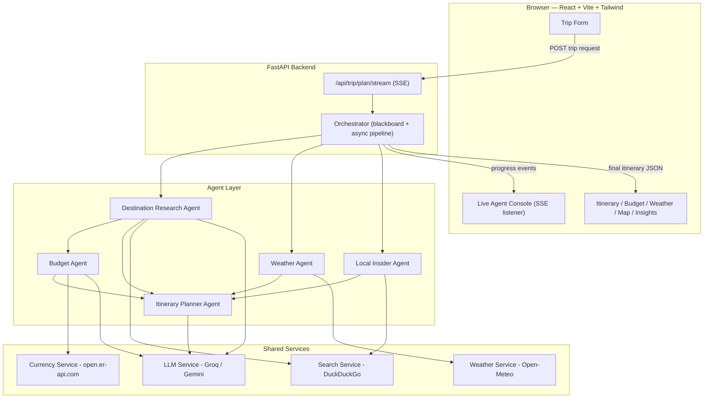

# TravelMind — Multi-Agent AI Travel Planner

TravelMind plans a complete trip — day-by-day itinerary, live weather, a real
cost breakdown in your currency, and current local conditions — by sending
five cooperating AI agents to research it in parallel, in real time, in
front of you. It's a full-stack, agentic AI/ML application built entirely on
**free-tier tools**.

## 1. What real-time problem does this solve?

Planning a trip today means manually stitching together stale, scattered
information: attraction lists from old blog posts, a separate weather app,
manual currency conversion for a guessed budget, and no visibility into
what's *currently* happening at the destination (festivals, advisories,
entry-rule changes) until you're already there.

## 2. Our solution

TravelMind treats trip planning as a multi-agent reasoning problem:

| Agent | Responsibility | Real-time data source |
|---|---|---|
| **Destination Research Agent** | Attractions, culture, best areas to stay | Live web search (DuckDuckGo) |
| **Weather Agent** | Forecast for exact travel dates + geocoding | Open-Meteo (free, no key) |
| **Budget Agent** | Cost breakdown converted to your currency | Live FX rates (open.er-api.com) |
| **Local Insider Agent** | Current events, advisories, entry requirements | Live web search (DuckDuckGo) |
| **Itinerary Planner Agent** | Synthesizes everything into a paced day-by-day plan | Reads shared context from all other agents |

An **Orchestrator** runs independent agents concurrently and streams every
status update to the browser over Server-Sent Events the moment it happens.

## 3. Who are the end users?

Individual leisure travelers, budget-conscious travelers/students, travel
agencies/freelance planners drafting first-pass itineraries, and corporate
travel coordinators working with fixed budgets and compressed timelines.

## 4. How scalable is it?

- Stateless FastAPI backend — scales horizontally behind a load balancer
- Independent agents run concurrently per request (`asyncio.gather`)
- SSE streaming avoids long blocking requests
- Provider-agnostic LLM layer — swap Groq/Gemini/others in one file
- Natural caching points (weather, FX, destination research) not yet
  implemented but straightforward to add with Redis for real traffic

## 5. Is it cost-effective? Future scope?

**Cost today: $0.** Groq/Gemini free tiers, Open-Meteo, open.er-api.com,
DuckDuckGo search, and OpenStreetMap tiles are all genuinely free, no card.

**Future scope:** a Booking Agent against a flights/hotels API, user
accounts + saved trips, a Redis caching layer, collaborative planning,
conversational edits ("swap day 3's museum"), and near-zero-cost deployment
(Vercel/Netlify + Render/Fly.io free tiers).

## Architecture



**Pattern used:** blackboard + pipeline. A shared `context` dict is the
blackboard every agent reads/writes; independent agents run concurrently,
dependent agents run after their dependencies resolve.

## Project structure

```
travelmind/
├── backend/
│   ├── app/
│   │   ├── agents/            # 5 specialist agents + orchestrator
│   │   ├── services/          # LLM, weather, currency, search
│   │   ├── models/            # Pydantic schemas
│   │   ├── routers/           # FastAPI routes (SSE + REST)
│   │   ├── config.py
│   │   └── main.py
│   ├── list_gemini_models.py  # diagnostic: see which Gemini models your key supports
│   ├── requirements.txt
│   └── .env.example
├── frontend/
│   └── src/                   # React components, SSE client, styles
└── docs/
    └── SETUP.md                # full step-by-step + troubleshooting
```

## Quick start

See **[docs/SETUP.md](docs/SETUP.md)** for full instructions and a
troubleshooting section covering common Windows/pip issues.

```bash
# Backend
cd backend
python -m venv venv && source venv/bin/activate   # Windows: .\venv\Scripts\Activate.ps1
pip install -r requirements.txt
cp .env.example .env      # add your free Groq or Gemini key
uvicorn app.main:app --reload --port 8000

# Frontend (second terminal)
cd frontend
npm install
npm run dev
```

Open **http://localhost:5173**.

## License

MIT — see [LICENSE](LICENSE).
